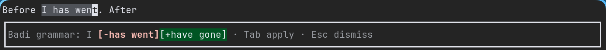
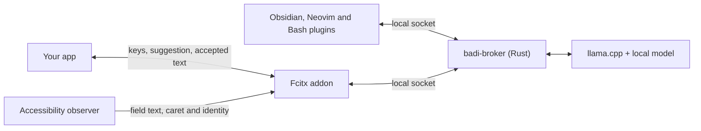

# Badi

**Local, private next-word suggestions for Linux.** While you type in an app you
allow, a small model on your own machine suggests the next few words, finishes
half-typed English words and fixes typos. In browsers and apps Badi can observe
on Hyprland, the suggestion shows as grey text at the caret; elsewhere (KDE
Plasma, GNOME, terminals and manual Fcitx apps) it shows as an Fcitx candidate. Nothing
changes until you accept it: `Tab` takes the next word of a continuation (a
typo fix or revision applies whole), and `Ctrl+→` (or clicking the Fcitx
candidate) takes it all.

[](https://github.com/ahuray/badi/actions/workflows/ci.yml)
[](LICENSE)


*Badi (`بعدی`) is Persian for “next”.*



## Features

- **Next words as you type:** up to four words (`badi length short` for one or
  two); other languages than English get whole words only, in English and German by default, and French, Spanish and
  Portuguese when you turn them on (`badi languages`; Persian only through
  `badi suggest fa on`, which `badi languages` and the panel do not offer).
  Right after a space, a suggestion appears only in a language the model heals
  (Gemma 3 1B: all of these; Qwen and Llama: English and Persian);
  `badi suggest LANG healing on` overrides that. With Gemma 3 1B, a 0.3 GB
  helper model makes English suggestions less generic
  ([how](broker/README.md#contrastive-first-token)).
- **Typo fixes:** `teh → the` in English out of the box; German, French, Spanish,
  Italian, Dutch and Polish after `badi spelling LANG on` and that language's
  Hunspell package (`badi spelling` names it).
- **Revise a selection:** select text on one line (character-wise `v` in Neovim)
  in a plain text field, Obsidian or Neovim and press `Ctrl+Shift+Space` for a
  grammar fix; press again for a refined wording, and again for a synonym of a
  short phrase. Revision covers English, German, French, Spanish and Portuguese. Rich editors and LibreOffice Writer are not supported yet. This
  uses a second model, Qwen3 1.7B, that `badi revise install` downloads.
- **Private by design:** the model runs on your CPU in a service with no
  network access, and Badi reads only fields you allowed (with context on, also
  text near them, never kept). See [Privacy](#privacy).
- **Your keyboard stays yours:** Badi runs beside your Fcitx 5 input method,
  never submits anything, and steps aside while another input method composes.
- **Where you write:** browsers and web apps, VS Code, Telegram, LibreOffice
  Writer, Obsidian, Neovim, Bash and terminals ([full list](#where-it-works)).

Badi is pre-release software for Wayland desktops, built first for
[Omarchy](https://omarchy.org) on Hyprland and also tested on KDE Plasma 6 and
GNOME. X11 is not supported.

## Quick start

Badi needs `x86_64` Linux with AVX2 and glibc 2.34 or later, a Wayland session
whose services run under `systemd --user`, PipeWire, and Fcitx 5 (5.1.23 or
later on Hyprland, Sway and other input-method-v2 compositors, 5.1.7 or later
on GNOME and KDE Plasma). On Omarchy or Arch Linux:

1. Install the build and runtime packages, and get the code:

   ```sh
   sudo pacman -S --needed base-devel git rust cmake ninja nlohmann-json fcitx5 gtk4 \
     gtk4-layer-shell python python-gobject python-cairo at-spi2-core pipewire curl
   git clone https://github.com/ahuray/badi && cd badi
   ```

2. Fetch the pinned `llama.cpp` runtime with the commands in
   [Writing assets](packaging/aur/README.md#writing-assets).
3. Install Badi. The installer offers the models that fit your machine and
   downloads the one you pick:

   ```sh
   python3 scripts/install-desktop.py      # services, Fcitx addon and the `badi` command
   python3 scripts/install-omarchy-ui.py   # Omarchy only: bar mark and settings panel
   ```

   On Omarchy, Badi is ready at once. On plain Arch, log out and back in so
   Fcitx loads the addon; a compositor started from a TTY must also start
   `graphical-session.target` (through a display manager, `uwsm`, or
   `systemctl --user start graphical-session.target`). On GNOME, then run
   `gnome-extensions enable badi-focus@ahuray.github.io`.
4. Check the setup with `badi doctor`, then allow an app and start typing
   (`badi revise install` adds the model for revising a selection):

   ```sh
   badi app omawrite on                    # or: badi site https://example.com on
   ```

On Omarchy, click the **b** in the bar instead: it walks you through languages,
apps and websites. The Arch and Debian packages start paused with nothing
allowed, so run `badi resume` after allowing an app.

**Other systems and options:**
- [Debian 13 and Ubuntu 24.04](packaging/debian/README.md): a `.deb` package and
  setup for KDE Plasma and GNOME.
- [Arch package](packaging/aur/README.md): a `makepkg` candidate, not on the AUR
  yet.
- Editor integrations: `python3 scripts/install-editors.py` with any of
  `--vault /path/to/vault` (Obsidian; run `npm ci` first), `--bash`, `--neovim`
  and `--libreoffice` (close LibreOffice first). Building the Obsidian plugin
  needs Node.js `^22.20`, `^24.12` or 25+; Bash and Neovim need only `node` on
  `PATH` (Node 18 and 20 are [tested](packaging/debian/README.md)); `--bash`
  also needs a C compiler and the Readline headers ([editors runbook](adapters/shared/README.md)).
- Chromium-based apps need [renderer accessibility](adapters/accessibility/README.md#installation-and-the-renderer-flag).
  On Omarchy run `python3 scripts/install-desktop.py --observed-app APP` with
  `chromium`, `brave-origin`, `code` (VS Code), `cursor`, `chatgpt` (Codex),
  `com.anthropic.claude`, `discord` or `grok-bot`, then relaunch the app.
- Every installer backs up what it replaces and can
  [roll back](adapters/fcitx5/README.md#install-and-roll-back).

## Keys

| Key | What it does |
| --- | --- |
| `Tab` | Accept the next word, drawn a little brighter on Hyprland (a typo fix or revision applies whole). In manual Fcitx apps such as Xournal++, `Tab` at the end of a phrase first asks for a suggestion. With nothing showing, `Tab` stays `Tab` |
| `Ctrl+→` | Accept the whole suggestion (in Fcitx apps also `Ctrl+Shift+Y`, or a click on the single suggestion; in the numbered list a click picks like `1`–`4`) |
| Keep typing | Typing the suggested letters keeps the rest, with no new model call |
| `Escape` | Dismiss |
| `Ctrl+Shift+Space` | Ask for a suggestion. On a suggestion, list other first words to pick with `1`–`4`. On selected text, show a grammar fix; each further press while it shows moves to a refined wording, then, for a phrase of up to three words, a synonym. `Tab` applies the one on screen |
| `Ctrl+Shift+Tab` | In Fcitx apps, send the app a real `Tab` while Badi would take it; elsewhere it stays the app's key |

Bash uses `Ctrl-X Tab` to request and accept. LibreOffice Writer uses `Alt+F7`
for spelling, or the infobar's **Replace** button on GNOME, where `Alt+F7` moves
the window. The full key behaviour is in each surface's runbook:
[Fcitx apps](adapters/fcitx5/README.md), [Obsidian](adapters/shared/README.md),
[Neovim](adapters/neovim/README.md), [Bash](adapters/shell/README.md) and
[Writer](adapters/libreoffice/README.md).

## Where it works

| Where | How | Notes |
| --- | --- | --- |
| Chromium, Brave Origin and their web apps | Fcitx, read through accessibility | Any site you allow, including rich editors |
| Zen and Zen Twilight | Fcitx, read through accessibility | No extra flags |
| VS Code, Cursor, Codex, Claude, Discord, Grok Bot | Fcitx, read through accessibility | VS Code needs `"editor.editContext": false` |
| LibreOffice Writer | Fcitx and the [Badi extension](adapters/libreoffice/README.md) | Spelling in one undo step |
| Telegram, Omawrite | Fcitx (Qt) | No typo replacement with `fcitx5-qt` 5.1.16 |
| Xournal++, Kate, Mousepad, GNOME Text Editor | Fcitx, on request | Allow it with `badi app`; `Tab` asks, `Tab` again accepts |
| Obsidian, Neovim | Badi plugins | Exact edits and native undo |
| Bash | Readline | Never submits a command |
| Ghostty, foot (any TUI) | The line you type | Allow it with `badi app`; typo fixes such as `teh → the` |

Not yet: Firefox (other than Zen), editors built on Chromium's EditContext, a
caret inside a list, quote, table or image in a rich editor, and terminals other
than Ghostty and foot.

In apps without an editor channel, Badi accepts with one append, like typed
text, so undo may merge it with your typing
([why](docs/decisions/0003-ime-parity-append-only.md)). The exact versions tested are in
the [Fcitx](adapters/fcitx5/README.md#tested-with),
[observer](adapters/accessibility/README.md#tested-with) and
[Debian](packaging/debian/README.md#tested-with) runbooks.

## Choose where Badi writes

```sh
badi app telegram on                # allow an app (badi app list, badi app NAME reset)
badi site https://example.com on    # allow a website
badi apps blocklist                 # or: every observed app except blocked ones
                                    # (manual apps, Ghostty and foot still need badi app)
badi languages en de fr             # the languages you write in
badi pause                          # badi resume; badi snooze quiets the focused app or site for 10 minutes
badi model                          # your model, the recommendation and the choices
badi model use gemma-3-1b           # download (pinned, hash-checked) and switch; adds the English helper
badi length short                   # one or two words; badi length normal for up to four
badi stats                          # words saved per day and app, counts only
badi doctor                         # what is wrong, if anything
badi --help                         # every command
```

The Omarchy settings panel offers the same settings; `badi doctor`, `badi stats`
and `badi --help` stay terminal commands.

**Opt-in extras:**
- [Context](docs/decisions/0010-context-finishes-words.md) (`badi context on`)
  finishes a word from text near the field and words you wrote before.
- [Style learning](broker/README.md#style-learning-opt-in) (`badi style on`)
  keeps sealed samples of your writing; suggestions do not use them yet.
- `badi battery quiet|normal|explicit` (default `quiet`: wait for a typing
  pause on battery), `badi screen-share hold|suggest` (default `hold`: no
  suggestions while you share your screen) and `badi mid-line on|off` (default
  `off`: no suggestion when a word follows the caret).

## Privacy

- **The model runs locally:** in a service with no IP network
  (`PrivateNetwork=yes`) and a read-only home outside Badi's own folders.
- **Only fields you allow:** password fields are always refused, and so are
  fields labelled for credentials wherever Badi can read the label.
- **No text kept:** drafts and window text stay in memory. Files on disk hold
  settings, counts, and, only if you opt in, encrypted learned words and style
  samples.
- **Downloads only on request:** the pinned runtime and models download only
  when you ask, with each file checked against a pinned hash. Model weights
  keep their own licences: Apache-2.0 for Qwen, plus the
  [Gemma](https://ai.google.dev/gemma/terms) and
  [Llama 3.2](https://www.llama.com/llama3_2/license/) terms, which you accept
  before those downloads.
- **Tracing off by default:** `badi debug on` records no text unless you add
  `--text`, and it ends itself after 15 minutes.

The full contract is in [VISION.md](VISION.md#context-firewall).

## When nothing appears

```sh
badi doctor                                     # setup and startup problems
badi status                                     # why the last request showed nothing
badi debug on && badi debug watch               # a live, text-free trace of every step
printf 'Please find attached the' | badictl probe -   # try the model directly
```

Right after a space, a language the model does not heal shows nothing:
`badi suggest` lists each language's healing, and `badi suggest LANG healing on`
turns it on. The [broker runbook](broker/README.md#debug-trace) explains every
trace event and no-suggestion reason.

## How it works



The editor plugins read their own text; the observer serves only the Fcitx
addon. The broker owns the policy and the editing authority, and every
suggestion is bound to the exact field, text and caret it was made for. See
[AGENTS.md](AGENTS.md#architecture) for the components and
[docs/decisions](docs/decisions/) for the design decisions.

## Contributing

Contributions are welcome. Read [CONTRIBUTING.md](CONTRIBUTING.md) first, and
report security issues privately as described in [SECURITY.md](SECURITY.md).

```sh
npm ci && npm run check                         # repository checks
cargo test --workspace --all-features --locked  # broker and Rust tests
```

| Read | For |
| --- | --- |
| [AGENTS.md](AGENTS.md) | Architecture, invariants and checks, for people and coding agents |
| [VISION.md](VISION.md) | The product contract |
| [future plans.md](<future plans.md>) | The backlog |
| [CHANGELOG.md](CHANGELOG.md) | What shipped |

## License

MIT ([LICENSE](LICENSE)). Bundled components and their licences are listed in
[THIRD-PARTY-NOTICES.txt](THIRD-PARTY-NOTICES.txt). Model weights keep their own
licences.
